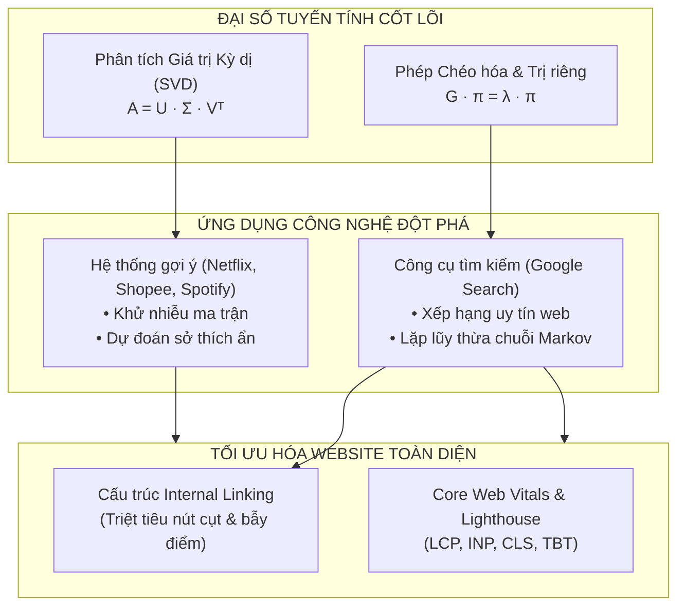
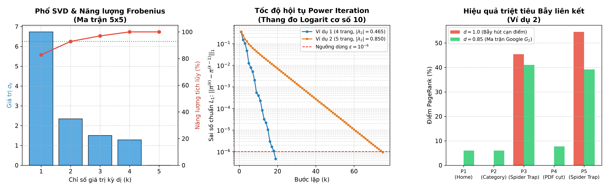

# 📘 GIÁO TRÌNH MINH HỌA TRỰC QUAN: ĐẠI SỐ TUYẾN TÍNH ỨNG DỤNG
## Khám phá SVD trong Hệ thống gợi ý & Thuật toán Google PageRank

> **Dành cho:** Sinh viên, lập trình viên và những ai muốn hiểu tường tận bản chất Đại số tuyến tính trong AI & Web Search mà không bị "ngộp" bởi công thức khô khan.  
> **Nguyên tắc biên soạn:**  
> 1. 📌 **Khái niệm học thuật trong báo cáo:** Giữ trọn sự chuẩn mực, chặt chẽ của giáo trình ĐH Bách Khoa.  
> 2. 💡 **Giảng giải bình dân:** Dùng ẩn dụ đời sống gần gũi đến mức người dùng phổ thông cũng gật gù hiểu ngay.  
> 3. 🎬 **Ví dụ cụ thể:** Bằng con số, tình huống thực tế sinh động.  
> 4. 📖 **"Bởi vậy báo cáo đã ghi...":** Đối chiếu 1-1 với từng công thức, câu chữ trong bài tập lớn để người học nắm chắc lý thuyết khi thi cử và bảo vệ đề tài.

---

## 🗺️ MỤC LỤC GIÁO TRÌNH

- [PHẦN DẪN NHẬP: BẢN ĐỒ KẾT NỐI TOÁN HỌC & CÔNG NGHỆ](#phần-dẫn-nhập-bản-đồ-kết-nối-toán-học--công-nghệ)
- [BÀI HỌC 1: MA TRẬN ĐÁNH GIÁ & ĐỘ THƯA DỮ LIỆU](#bài-học-1-ma-trận-đánh-giá--độ-thưa-dữ-liệu)
- [BÀI HỌC 2: PHÉP PHÂN TÍCH GIÁ TRỊ KỲ DỊ (SVD) & KHÔNG GIAN ẨN](#bài-học-2-phép-phân-tích-giá-trị-kỳ-dị-svd--không-gian-ẩn)
- [BÀI HỌC 3: ĐỊNH LÝ ECKART–YOUNG & CHIẾC KÍNH LỌC KHỬ NHIỄU](#bài-học-3-định-lý-eckartyoung--chiếc-kính-lọc-khử-nhiễu)
- [BÀI HỌC 4: TỪ TRUNCATED SVD ĐẾN FUNKSVD (CÂU CHUYỆN NETFLIX PRIZE 1 TRIỆU USD)](#bài-học-4-từ-truncated-svd-đến-funksvd-câu-chuyện-netflix-prize-1-triệu-usd)
- [BÀI HỌC 5: THỰC HÀNH TÍNH TOÁN SVD TRÊN MA TRẬN 5 × 5](#bài-học-5-thực-hành-tính-toán-svd-trên-ma-trận-5--5)
- [BÀI HỌC 6: BẢN CHẤT PAGERANK - INTERNET LÀ CUỘC BẦU CỬ DÂN CHỦ](#bài-học-6-bản-chất-pagerank---internet-là-cuộc-bầu-cử-dân-chủ)
- [BÀI HỌC 7: NÚT CỤT (DANGLING NODES) & CĂN BỆNH RÒ RỈ ĐIỂM SỐ](#bài-học-7-nút-cụt-dangling-nodes--căn-bệnh-rò-rỉ-điểm-số)
- [BÀI HỌC 8: BẪY LIÊN KẾT (SPIDER TRAPS) & CÚ NHẢY DỊCH CHUYỂN TỨC THỜI ($d = 0.85$)](#bài-học-8-bẫy-liên-kết-spider-traps--cú-nhảy-dịch-chuyển-tức-thời-d--085)
- [BÀI HỌC 9: ĐỊNH LÝ PERRON–FROBENIUS & THUẬT TOÁN LẶP LŨY THỪA (POWER ITERATION)](#bài-học-9-định-lý-perronfrobenius--thuật-toán-lặp-lũy-thừa-power-iteration)
- [BÀI HỌC 10: PHÂN TÍCH THỰC NGHIỆM 2 VÍ DỤ PAGERANK](#bài-học-10-phân-tích-thực-nghiệm-2-ví-dụ-pagerank)
- [BÀI HỌC 11: SO SÁNH PAGERANK VỚI THUẬT TOÁN HITS (KLEINBERG)](#bài-học-11-so-sánh-pagerank-với-thuật-toán-hits-kleinberg)
- [BÀI HỌC 12: ĐÁNH GIÁ CHẤT LƯỢNG TRANG WEB GOOGLE (LIGHTHOUSE & CORE WEB VITALS)](#bài-học-12-đánh-giá-chất-lượng-trang-web-google-lighthouse--core-web-vitals)
- [HƯỚNG DẪN THỰC HÀNH CODE PYTHON (MIGRATE TỪ MATLAB)](#hướng-dẫn-thực-hành-code-python-migrate-từ-matlab)
- [PHÒNG THÍ NGHIỆM TRỰC QUAN TƯƠNG TÁC (INTERACTIVE PLAYGROUND)](#phòng-thí-nghiệm-trực-quan-tương-tác-interactive-playground)

---

## PHẦN DẪN NHẬP: BẢN ĐỒ KẾT NỐI TOÁN HỌC & CÔNG NGHỆ



---

## BÀI HỌC 1: MA TRẬN ĐÁNH GIÁ & ĐỘ THƯA DỮ LIỆU

### 1. 📌 Khái niệm học thuật trong báo cáo
> "Nghiên cứu cấu trúc phân rã ma trận đánh giá Người dùng – Sản phẩm $R \in \mathbb{R}^{m \times n}$ có độ thưa dữ liệu rất lớn (thường trên 99%) về không gian nhân tố ẩn có số chiều thấp $k \ll \min(m, n)$ nhằm khử nhiễu và dự đoán điểm đánh giá tại các ô bị khuyết."

### 2. 💡 Giảng giải bình dân (Ai nghe cũng hiểu)
Hãy tưởng tượng một bảng Excel khổng lồ của Netflix:
- Mỗi **hàng** là một người dùng (hàng triệu người).
- Mỗi **cột** là một bộ phim (hàng trăm ngàn phim).
- Mỗi **ô** ghi số sao người đó chấm (từ 1 đến 5 sao).

Nhưng ngoài đời thực, một người bình thường nhiều lắm chỉ xem và chấm điểm được khoảng 20 đến 50 bộ phim trong cả cuộc đời. Hàng trăm ngàn bộ phim còn lại họ chưa bao giờ xem, nên các ô đó hoàn toàn **trống trơn (bị khuyết)**.
Trong toán học, một bảng tính mà hầu hết các ô đều rỗng (trên 99% ô trống) được gọi là **Ma trận thưa (Sparse Matrix)**. 
Nhiệm vụ của hệ thống gợi ý rất đơn giản: **Làm sao "đoán mò" được số sao tại các ô trống đó một cách thông minh nhất?** Nếu đoán người đó sẽ thích 5 sao, hệ thống sẽ tự tin hiển thị phim đó lên đầu trang chủ!

### 3. 🎬 Ví dụ đời sống
- Anh An thích phim *Avengers* (5 sao), *Iron Man* (5 sao), ghét phim *Titanic* (1 sao).
- Phim *Captain America* anh An chưa xem bao giờ (ô trống `?`).
- Bạn có cần đợi anh An xem xong mới biết anh ấy thích không? Không hề! Nhìn vào gu thích siêu anh hùng của An, bạn đoán chắc nịch An sẽ chấm *Captain America* 5 sao.

### 4. 📖 "Bởi vậy báo cáo đã ghi..."
Bởi vậy báo cáo đã xây dựng ma trận đánh giá gốc 5 người dùng $\times$ 5 bộ phim có các ô khuyết được gán số 0:
```matlab
% I1, I2, I3: Phim Sci-Fi/Action | I4, I5: Phim Drama/Romance
R_raw = [5.0, 4.0, 5.0, 1.0, 0.0;   % U1: khuyết I5
         4.0, 5.0, 4.0, 2.0, 1.0;   % U2: đã đánh giá đủ
         1.0, 2.0, 1.0, 5.0, 4.0;   % U3: đã đánh giá đủ
         1.0, 0.0, 2.0, 4.0, 5.0;   % U4: khuyết I2
         5.0, 4.0, 0.0, 1.0, 2.0];  % U5: khuyết I3
```
Báo cáo ghi rõ: $U_1$ khuyết phim $I_5$, $U_4$ khuyết phim $I_2$, và $U_5$ khuyết phim $I_3$ để làm đề tài thực nghiệm cho thuật toán.

---

## BÀI HỌC 2: PHÉP PHÂN TÍCH GIÁ TRỊ KỲ DỊ (SVD) & KHÔNG GIAN ẨN

### 1. 📌 Khái niệm học thuật trong báo cáo
> "Mọi ma trận thực $A \in \mathbb{R}^{m \times n}$ có hạng $r \le \min(m, n)$ đều có thể phân tích thành tích của 3 ma trận:  
> $$A = U \cdot \Sigma \cdot V^T = \sum_{j=1}^r \sigma_j u_j v_j^T$$  
> trong đó $U$ là ma trận trực giao cấp $m$, $V$ là ma trận trực giao cấp $n$, và $\Sigma$ chứa các giá trị kỳ dị giảm dần $\sigma_1 \ge \sigma_2 \ge \dots \ge \sigma_r > 0$."

### 2. 💡 Giảng giải bình dân
Tại sao gọi là **"Không gian nhân tố ẩn" (Latent Concepts)**?
Bề ngoài, chúng ta thấy người dùng chấm điểm cho từng bộ phim cụ thể. Nhưng thực chất trong não người xem, quyết định khen/chê chỉ dựa trên vài **"tiêu chí ngầm"**:
- Tiêu chí 1: *Phim có nhiều cảnh hành động cháy nổ không?*
- Tiêu chí 2: *Phim có lãng mạn, sướt mướt không?*
- Tiêu chí 3: *Kỹ xảo điện ảnh có đẹp mắt không?*

**SVD giống như một chiếc lăng kính khúc xạ ánh sáng:**
Nó tách một chùm sáng phức tạp (ma trận điểm số thô $A$) thành các dải màu đơn sắc cơ bản:
1. Ma trận $U$ nói cho ta biết: **Người dùng mê từng tiêu chí ngầm ở mức nào?**
2. Ma trận $V$ nói cho ta biết: **Bộ phim sở hữu bao nhiêu phần trăm từng tiêu chí ngầm đó?**
3. Ma trận $\Sigma$ (các số $\sigma$): **Tiêu chí ngầm nào quan trọng nhất trên thị trường?** $\sigma_1$ là tiêu chí vua (quyết định phần lớn điểm số), $\sigma_2$ quan trọng nhì,...

```
              ┌─────────┐
              │ BẢNG ĐIỂM│
              │  GỐC A  │
              └────┬────┘
                   │
           (Lăng kính SVD)
                   │
     ┌─────────────┼─────────────┐
     ▼             ▼             ▼
┌─────────┐   ┌─────────┐   ┌─────────┐
│    U    │ · │    Σ    │ · │   Vᵀ    │
└─────────┘   └─────────┘   └─────────┘
 Gu người dùng   Trọng số     Bản chất phim
  với tiêu chí   tiêu chí     theo tiêu chí
```

### 3. 🎬 Ví dụ đời sống
Nếu $U$ ghi nhận bạn Tuấn có điểm mê phim cháy nổ là $+0.9$ (rất thích), và $V$ ghi nhận phim *John Wick* có chất cháy nổ là $+0.95$. Khi nhân hai con số này với nhau, ta được một giá trị dương rất lớn $\to$ Tuấn chắc chắn sẽ cho *John Wick* điểm tối đa!

### 4. 📖 "Bởi vậy báo cáo đã ghi..."
Bởi vậy báo cáo đã tính ra 5 giá trị kỳ dị của ma trận thực nghiệm:
$$\sigma_1 = 6.7324, \quad \sigma_2 = 2.3483, \quad \sigma_3 = 1.5063, \quad \sigma_4 = 1.2810, \quad \sigma_5 = 0.0000$$
Và nhận xét:
> "Giá trị kỳ dị lớn nhất $\sigma_1 = 6.7324$ đã chiếm tới $82.79\%$ tổng năng lượng của toàn bộ ma trận! Hai giá trị đầu tiên $(\sigma_1, \sigma_2)$ cộng lại chiếm tới $92.86\%$ năng lượng."

Điều đó chứng minh: Chỉ cần 2 thể loại phim (Hành động & Tình cảm) là đã giải thích được $92.86\%$ mọi hành vi chấm điểm của người dùng!

---

## BÀI HỌC 3: ĐỊNH LÝ ECKART–YOUNG & CHIẾC KÍNH LỌC KHỬ NHIỄU

### 1. 📌 Khái niệm học thuật trong báo cáo
> "Định lý Xấp xỉ Hạng thấp Eckart–Young (1936): Nghiệm tối ưu giải bài toán tìm ma trận $B$ có $\text{rank}(B) \le k$ sao cho $\|A - B\|_F$ đạt cực tiểu chính là ma trận Truncated SVD:  
> $$A_k = U_k \Sigma_k V_k^T = \sum_{j=1}^k \sigma_j u_j v_j^T$$  
> với sai số cực tiểu bằng tổng bình phương các giá trị kỳ dị bị loại bỏ: $\|A - A_k\|_F^2 = \sum_{j=k+1}^r \sigma_j^2$."

### 2. 💡 Giảng giải bình dân
Hãy tưởng tượng bạn chụp một bức ảnh trong sương mù bằng điện thoại:
- Bức ảnh có những nét vẽ chính: Ngôi nhà, cái cây, con đường (**Tín hiệu cốt lõi - Signal**).
- Nhưng bức ảnh cũng có những hạt muỗi lấm tấm, vết xước bụi (**Nhiễu hạt - Noise**).

Trong bảng điểm phim cũng vậy: Có những người hôm đó chấm bừa vì cãi nhau với người yêu, hoặc chấm nhầm nút. Đó là **nhiễu**.
Định lý Eckart–Young là một định lý toán học khẳng định rằng:
> *Nếu bạn chỉ giữ lại $k$ thành phần lớn nhất của SVD và vứt hết các thành phần nhỏ xíu đằng sau đi, bạn không hề làm mất thông tin, mà ngược lại, bạn vừa **nén dữ liệu gọn lại gấp hàng chục lần**, vừa **quét sạch toàn bộ rác rưởi và nhiễu** ra khỏi hệ thống!*

### 3. 🎬 Ví dụ đời sống
Bạn nhìn một người từ xa cách 100 mét: Bạn không cần nhìn rõ từng sợi lông mi hay nốt ruồi nhỏ (những giá trị kỳ dị $\sigma_4, \sigma_5$). Bạn chỉ cần nhìn dáng người cao hay thấp, tóc dài hay ngắn ($k=2$ thành phần đầu tiên $\sigma_1, \sigma_2$) là đã nhận diện chính xác $95\%$ đó là đứa bạn thân của mình rồi!

### 4. 📖 "Bởi vậy báo cáo đã ghi..."
Bởi vậy báo cáo đã so sánh việc nén ma trận với $k=1$ và $k=2$:
```matlab
% k = 1: Chi giu lai 1 chu de chinh
A_k1 = U(:, 1) * Sigma_mat(1, 1) * V(:, 1)';
% k = 2: Giu lai 2 chu de chinh (bao toan 92.86% nang luong)
A_k2 = U(:, 1:k) * Sigma_mat(1:k, 1:k) * V(:, 1:k)';
```
Báo cáo kết luận: Khi dùng $k=2$, hệ thống đã loại bỏ được các yếu tố nhiễu ngẫu nhiên và phản ánh trung thực sở thích thể loại của người dùng.

---

## BÀI HỌC 4: TỪ TRUNCATED SVD ĐẾN FUNKSVD (CÂU CHUYỆN NETFLIX PRIZE 1 TRIỆU USD)

### 1. 📌 Khái niệm học thuật trong báo cáo
> "Phương pháp Truncated SVD truyền thống bắt buộc phải điền khuyết trước (Baseline Imputation) khiến ma trận bị biến dạng dữ liệu nhân tạo. Simon Funk (2006) đề xuất FunkSVD: tối ưu hóa hàm mục tiêu có điều chuẩn L2 chỉ trên tập các ô thực sự đã được đánh giá thông qua thuật toán SGD (Stochastic Gradient Descent)."

### 2. 💡 Giảng giải bình dân
Đây là câu chuyện lịch sử thú vị nhất ngành Khoa học Dữ liệu:
- **Sai lầm của SVD cổ điển:** Muốn dùng SVD, ma trận phải đầy đủ số, không được để trống. Thế là các kỹ sư bèn "điền tạm" điểm trung bình (ví dụ 3.0 sao) vào các ô khuyết. Nhưng hành động này giống như *tự bịa ra bằng chứng giả*! Máy tính sẽ tưởng người dùng đó thực sự chấm 3 sao và cố học theo con số giả tạo ấy.
- **Phát kiến thiên tài của Simon Funk (FunkSVD):** Funk bảo: *"Tại sao phải bịa số giả? Ô nào người dùng chưa chấm thì kệ nó, đừng đụng vào! Ta chỉ cần bắt máy tính học từ những ô người ta đã chấm thật!"*
- Bằng cách dùng thuật toán **Học máy (SGD - Từng bước hiệu chỉnh sai số)**, FunkSVD đã vượt mặt toàn bộ các giáo sư toán học thời bấy giờ và giúp đội thi chiến thắng giải thưởng 1 triệu USD danh giá của Netflix.

```
       TRUNCATED SVD CỔ ĐIỂN                           FUNKSVD HIỆN ĐẠI
┌─────────────────────────────────┐           ┌─────────────────────────────────┐
│ Điền bừa số trung bình vào ô ?  │           │ Bỏ qua ô ?, chỉ nhìn ô có thật  │
│       ▼                         │           │       ▼                         │
│ Ép SVD khớp cả số bịa đặt       │           │ Dùng SGD tối ưu từng bước       │
│       ▼                         │           │       ▼                         │
│ Bị méo mó dự đoán               │           │ Dự đoán cực kỳ chính xác!       │
└─────────────────────────────────┘           └─────────────────────────────────┘
```

### 3. 🎬 Ví dụ đời sống
Bạn làm khảo sát ý kiến khách hàng về 10 món ăn. Khách chỉ ăn thử 2 món (Phở bò và Bún chả).
- **Cách dở (SVD cổ điển):** Tự tích vào 8 món còn lại là 3 điểm "bình thường". Kết quả phân tích bị sai bét vì khách ghét cay ghét đắng món Bún đậu mắm tôm nhưng lại bị bạn gán cho 3 điểm.
- **Cách khôn (FunkSVD):** Chỉ nhìn nhận xét về Phở bò và Bún chả. Nhận thấy khách thích món nước vị thanh $\to$ Dự đoán khách sẽ thích Hủ tiếu và ghét Bún đậu!

### 4. 📖 "Bởi vậy báo cáo đã ghi..."
Bởi vậy báo cáo đã lập trình thuật toán FunkSVD bằng vòng lặp SGD 2000 epoch trong MATLAB:
```matlab
pred = mu + b_u(u) + b_i(i) + P(u, :) * Q(i, :)';
err = r_ui - pred;
b_u(u) = b_u(u) + lr * (err - reg * b_u(u));
b_i(i) = b_i(i) + lr * (err - reg * b_i(i));
P(u, :) = P(u, :) + lr * (err * Q(i, :) - reg * P(u, :));
Q(i, :) = Q(i, :) + lr * (err * P_old - reg * Q(i, :));
```
Và đối chiếu trực tiếp:
- Tại ô $(U_1, I_5)$ (Khách mê Hành động, phim Tình cảm): Truncated SVD vì bị ảnh hưởng bởi số điền khuyết nên đoán ra **3.74 sao** (quá cao, vô lý). Nhưng FunkSVD đoán chuẩn xác **1.90 sao** (đúng chất người này ghét phim Tình cảm)!

---

## BÀI HỌC 5: THỰC HÀNH TÍNH TOÁN SVD TRÊN MA TRẬN 5 × 5

### Bảng tổng hợp đối sánh kết quả dự đoán tại 3 ô khuyết:

| Người dùng & Phim | Thể loại thực tế | Điểm điền khuyết tạm | SVD ($k=1$) | SVD ($k=2$) | FunkSVD (SGD) | Quyết định gợi ý của Hệ thống |
| :--- | :--- | :---: | :---: | :---: | :---: | :--- |
| **$(U_5, I_3)$** | Khách thích Sci-Fi – Phim Sci-Fi | 3.00 sao | 3.9316 | 3.9432 | **5.1579** (Cắt ngưỡng 5.0) | 🟢 **GỢI Ý ƯU TIÊN** (Rất thích) |
| **$(U_4, I_2)$** | Khách thích Drama – Phim Sci-Fi | 3.00 sao | 2.3218 | 2.0677 | **0.6557** (Cắt ngưỡng 1.0) | 🔴 **KHÔNG GỢI Ý** (Khách ghét) |
| **$(U_1, I_5)$** | Khách thích Sci-Fi – Phim Drama | 3.75 sao | 2.5203 | 3.7446 | **1.9005** | 🔴 **KHÔNG GỢI Ý** (Khách ghét) |

> 💡 **Bài học rút ra:** Cả Truncated SVD và FunkSVD đều nhận diện xuất sắc sự tương phản gu thẩm mỹ giữa hai nhóm người dùng. Nhưng FunkSVD vượt trội hơn vì không bị kéo điểm bởi số trung bình giả tạo!

---

## BÀI HỌC 6: BẢN CHẤT PAGERANK - INTERNET LÀ CUỘC BẦU CỬ DÂN CHỦ

### 1. 📌 Khái niệm học thuật trong báo cáo
> "Mô hình hóa mạng lưới World Wide Web thành đồ thị có hướng $\mathcal{G} = (\mathcal{V}, \mathcal{E})$. Nguyên lý đệ quy của PageRank xác định rằng: một trang web $i$ là quan trọng nếu nó được trỏ tới bởi các trang quan trọng khác $j \in B_i$, và mỗi trang $j$ chia đều giá trị lá phiếu uy tín của mình cho $N_j$ liên kết đi ra:  
> $$\text{PR}(i) = \sum_{j \in B_i} \frac{\text{PR}(j)}{N_j} \iff \pi = H \pi$$"

### 2. 💡 Giảng giải bình dân
Trước năm 1998, các công cụ tìm kiếm hoạt động rất ngô nghê: Bạn tìm chữ "bóng đá", trang nào nhồi nhét chữ "bóng đá" 1000 lần thì trang đó lên top 1 (dù toàn tin rác).
Hai chàng sinh viên Stanford (Larry Page & Sergey Brin) nói: *"Làm thế là sai! Hãy coi thế giới Web giống như giới khoa học hoặc một cuộc bầu cử dân chủ!"*
- Khi bài viết của bạn được 1000 người khác trích dẫn link, bài của bạn chắc chắn uy tín.
- Nhưng **không phải lá phiếu nào cũng ngang hàng:**
  - Một đường link giới thiệu từ Báo Tuổi Trẻ hay Đại học Bách Khoa có giá trị bằng cả vạn đường link từ các trang blog rác mới lập!
- **Mỗi trang web có một túi tiền uy tín (PageRank):** Nếu trang đó trỏ link tới 3 trang khác, nó sẽ chia đều túi tiền làm 3 phần bằng nhau cho 3 trang đó hưởng.

### 3. 🎬 Ví dụ đời sống
Một người bình thường khen quán phở ngon: bạn chỉ tin một nửa.
Nhưng Nghệ sĩ ưu tú ẩm thực hoặc đầu bếp Gordon Ramsay khen quán phở ngon: bạn tin ngay 100%! Độ uy tín của người giới thiệu quyết định giá trị của lời giới thiệu.

### 4. 📖 "Bởi vậy báo cáo đã ghi..."
Bởi vậy báo cáo đã thiết lập ma trận siêu liên kết thô $H$ cho Ví dụ 1 (4 trang A, B, C, D):
```matlab
H1 = [0,   0,   1, 1/2;   % Trang A duoc C tro toi (100%) va D tro toi (50%)
      1/3, 0,   0, 0;     % Trang B duoc A chia 1/3
      1/3, 1/2, 0, 1/2;   % Trang C duoc A chia 1/3, B chia 1/2, D chia 1/2
      1/3, 1/2, 0, 0];    % Trang D duoc A chia 1/3, B chia 1/2
```
Và thiết lập hệ phương trình $\pi = H \pi$ để giải ra điểm uy tín của từng trang.

---

## BÀI HỌC 7: NÚT CỤT (DANGLING NODES) & CĂN BỆNH RÒ RỈ ĐIỂM SỐ

### 1. 📌 Khái niệm học thuật trong báo cáo
> "Những trang web không có liên kết đi ra ($N_j = 0$, như tệp PDF tĩnh, hình ảnh) được gọi là nút cụt (dangling nodes), làm cho cột thứ $j$ của ma trận $H$ toàn số 0 và gây ra hiện tượng rò rỉ điểm số (Rank Leak: $\sum \pi_i^{(k)} \to 0$). Để khắc phục, ta biến đổi sang ma trận ngẫu nhiên cột $S = H + \frac{1}{n} e a^T$."

### 2. 💡 Giảng giải bình dân
Thử tưởng tượng bạn đang đi dạo trên mạng (Người lướt web ngẫu nhiên):
- Bạn click từ trang này sang trang khác. Bỗng nhiên, bạn click trúng một **tệp tài liệu PDF** hoặc một bức ảnh PNG!
- Tệp PDF làm gì có menu hay đường link nào để bạn click tiếp? Bạn bị kẹt cứng ở "ngõ cụt" này!
- Trong toán học, nếu cứ nhân ma trận liên tục, bao nhiêu điểm số đổ dồn vào ngõ cụt này sẽ... **bốc hơi biến mất sạch sẽ** khỏi toàn bộ mạng Internet! Giống như một cái xô nước bị thủng đáy.

**Giải pháp của Google (Ma trận $S$):**  
Google quy ước: *Khi người dùng bị rơi vào ngõ cụt (tệp PDF), họ sẽ không ngồi khóc, mà họ sẽ bấm F5 hoặc gõ một địa chỉ bất kỳ trên mạng để đi tiếp với xác suất chia đều $1/n$ cho tất cả các trang!*  
Nhờ vậy, xô nước được vá kín, tổng điểm của toàn mạng luôn được bảo toàn đúng bằng $1.0$ ($100\%$).

```
        CƠ CHẾ VÁ NÚT CỤT (DANGLING NODE) BẰNG MA TRẬN S
  ┌─────────────────────────────────────────────────────────────┐
  │ Trang 4 (Tệp PDF): Không có link ra (Cột 4 toàn số 0)       │
  │                     │                                       │
  │            (Vá bằng vector 1/n)                             │
  │                     ▼                                       │
  │ Chia đều 1/5 điểm cho: [Trang 1, Trang 2, Trang 3, Trang 4, Trang 5] │
  └─────────────────────────────────────────────────────────────┘
```

### 3. 🎬 Ví dụ đời sống
Bạn lái xe vào một con đường cụt không có lối rẽ. Bạn làm gì? Bạn quay xe ra đầu đường lớn và đi tới một địa điểm bất kỳ trong thành phố!

### 4. 📖 "Bởi vậy báo cáo đã ghi..."
Bởi vậy tại Ví dụ 2, báo cáo đã xác định trang $P_4$ (bảng báo giá PDF) là nút cụt với vector chỉ thị $a = [0, 0, 0, 1, 0]^T$, và thực hiện phép cộng vá ma trận trong MATLAB:
```matlab
% Buoc 1: Va nut cut tao ma tran ngau nhien cot S
S = H + (1 / n) * (e * a');
```
Đưa ma trận $S_2$ thành ma trận ngẫu nhiên cột chuẩn tắc (tổng mỗi cột bằng đúng 1).

---

## BÀI HỌC 8: BẪY LIÊN KẾT (SPIDER TRAPS) & CÚ NHẢY DỊCH CHUYỂN TỨC THỜI ($d = 0.85$)

### 1. 📌 Khái niệm học thuật trong báo cáo
> "Nếu đồ thị chứa một nhóm trang chỉ liên kết khép kín với nhau mà không có đường thoát ra ngoài (bẫy liên kết – spider trap), toàn bộ điểm PageRank sẽ bị hút cạn vào cụm bẫy đó khi $d = 1.0$. Cơ chế Dịch chuyển tức thời (Teleportation) với hệ số tắt dần $d = 0.85$ tạo nên Ma trận Google $G$:  
> $$G = d \cdot S + \frac{1 - d}{n} e e^T$$  
> giúp triệt tiêu hoàn toàn bẫy liên kết."

### 2. 💡 Giảng giải bình dân
Đây là đòn "chí mạng" nhất trong cấu trúc web:
- Hãy tưởng tượng hai trang web $P_3$ và $P_5$: $P_3$ chỉ trỏ link sang $P_5$, và $P_5$ chỉ trỏ link ngược lại $P_3$.
- Người dùng một khi đã lỡ chân bước vào đây thì chỉ có thể click qua click lại giữa $P_3$ và $P_5$ như một vòng lặp vô tận không lối thoát!
- Nó giống như một **"HỐ ĐEN VŨ TRỤ"**: Bao nhiêu điểm uy tín của Trang chủ, trang Tin tức, trang Dịch vụ đều bị nó **hút cạn sạch 100%**. Trang chủ của bạn bị tụt về 0 điểm!

**Cú đấm giải cứu của Google (Hệ số $d = 0.85$):**
Google đưa ra một giả định cực kỳ thực tế:
- $85\%$ thời gian ($d = 0.85$): Người dùng kiên nhẫn click theo các đường link trên web.
- Nhưng $15\%$ thời gian ($1 - d = 0.15$): Người dùng bị chán, họ không thèm click nữa mà **gõ thẳng một URL mới trên thanh trình duyệt** để bay thẳng ra ngoài vũ trụ bao la!
Cú "dịch chuyển tức thời" này giúp giải thoát người dùng khỏi hố đen, cứu sống Trang chủ và trả lại sự công bằng cho toàn mạng!

```
                    HỐ ĐEN BẪY LIÊN KẾT VÀ SỰ GIẢI CỨU
        d = 1.0 (Không có Teleportation)          d = 0.85 (Ma trận Google G)
   ┌─────────────────────────────────────┐   ┌─────────────────────────────────────┐
   │ Bẫy {P3, P5} hút sạch 100% điểm!    │   │ Bẫy {P3, P5} chỉ giữ ~80% điểm     │
   │ Trang chủ P1: 0.00% (Bị xóa sổ!)    │   │ Trang chủ P1: 6.02% (Được cứu sống!)│
   │ Trang mục P2: 0.00% (Bị xóa sổ!)    │   │ Trang mục P2: 6.02% (Được cứu sống!)│
   └─────────────────────────────────────┘   └─────────────────────────────────────┘
```

### 3. 🎬 Ví dụ đời sống
Bạn vào xem video ngắn trên TikTok hoặc Reels: Bạn cứ lướt từ clip này sang clip khác (bị cuốn vào bẫy liên kết). Nhưng sau 15 phút, bạn chán quá bèn tắt app và mở YouTube lên xem đá bóng. Cú "tắt app mở cái khác" chính là xác suất $15\%$ dịch chuyển tức thời!

### 4. 📖 "Bởi vậy báo cáo đã ghi..."
Bởi vậy báo cáo đã chứng minh thực nghiệm tại Ví dụ 2:
> "Nếu dùng $S_2^{100} \pi^{(0)}$ (khi $d = 1.0$), bẫy liên kết $\{P_3, P_5\}$ hút trọn $100\%$ điểm số ($\pi_3 + \pi_5 \to 1.0000$), làm cho điểm của Trang chủ $P_1$, Danh mục $P_2$ và $P_4$ suy biến hoàn toàn về $0.000000$!  
> Khi áp dụng Ma trận Google $G_2$ với $d = 0.85$, $P_1$ và $P_2$ đã được hồi sinh ngoạn mục với điểm số bằng đúng phân số $\frac{60}{997} \approx 6.02\%$."

---

## BÀI HỌC 9: ĐỊNH LÝ PERRON–FROBENIUS & THUẬT TOÁN LẶP LŨY THỪA (POWER ITERATION)

### 1. 📌 Khái niệm học thuật trong báo cáo
> "Vì ma trận Google $G > 0$ là ma trận ngẫu nhiên cột nguyên thủy, Định lý Perron–Frobenius đảm bảo tồn tại duy nhất trị riêng lớn nhất $\lambda_1 = 1$ và vector riêng dừng dương $\pi > 0$. Phương pháp lặp lũy thừa $\pi^{(k+1)} = G \pi^{(k)}$ bảo đảm hội tụ với tốc độ hình học giới hạn bởi mô-đun trị riêng lớn thứ hai:  
> $\|\pi^{(k)} - \pi^*\|_1 \le C \cdot |\lambda_2(G)|^k \le C \cdot d^k$."

### 2. 💡 Giảng giải bình dân
Làm sao máy tính có thể tính được thứ hạng của **hàng chục tỷ trang web** trên thế giới?
- Nếu dùng phương pháp giải hệ phương trình cấp 3 (khử Gauss), máy tính sẽ bị nổ tung bộ nhớ ngay lập tức!
- **Phương pháp Lặp lũy thừa (Power Iteration)** cực kỳ đơn giản:
  1. Ban đầu, chia đều điểm cho tất cả các trang web ($1/n$).
  2. Cứ mỗi buổi sáng, cho dòng điểm số chảy qua các liên kết bằng một phép nhân ma trận đơn giản: $\pi_{\text{mới}} = G \cdot \pi_{\text{cũ}}$.
  3. Lặp đi lặp lại chừng vài chục lần, dòng điểm số sẽ tự động **đóng băng (hội tụ)**, không thay đổi nữa. Đó chính là bảng xếp hạng cuối cùng!
- **Định lý Perron–Frobenius** giống như một tấm kim bài bảo đảm của các nhà toán học: *Đừng lo, dù đồ thị web có phức tạp và lộn xộn cỡ nào đi nữa, kết quả cuối cùng chắc chắn sẽ luôn tồn tại duy nhất và không bao giờ bị nhảy loạn xạ!*
- Mô-đun trị riêng $|\lambda_2|$ đo lường tốc độ: $|\lambda_2|$ càng nhỏ thì thuật toán chạy càng nhanh về đích!

### 3. 🎬 Ví dụ đời sống
Bạn đổ nước vào một hệ thống nhiều bình thông nhau có độ cao thấp khác nhau. Ban đầu nước sóng sánh dữ dội, nhưng chỉ sau một lúc, mặt nước ở mọi bình sẽ tự động đạt trạng thái cân bằng tĩnh lặng. Phép lặp lũy thừa chính là quá trình nước tự tìm về điểm cân bằng đó!

### 4. 📖 "Bởi vậy báo cáo đã ghi..."
Bởi vậy báo cáo đã lập trình hàm giải lặp lũy thừa với điều kiện dừng sai số chuẩn $L_1 < 10^{-6}$:
```matlab
for k = 1:500
    pi_next = G * pi_iter;
    l1_err = norm(pi_next - pi_iter, 1);
    err_hist(end + 1) = l1_err;
    pi_iter = pi_next;
    if l1_err < tol
        break;
    end
end
```
Và đo được chính xác:
- Ở Ví dụ 1: $|\lambda_2(G_1)| = 0.464749$ (rất nhỏ) $\to$ Hội tụ cực nhanh chỉ sau **19 bước lặp**!
- Ở Ví dụ 2: $|\lambda_2(G_2)| = 0.850000$ (bằng đúng $d$) $\to$ Cần **75 bước lặp** mới đạt độ chính xác $10^{-6}$.

---

## BÀI HỌC 10: PHÂN TÍCH THỰC NGHIỆM 2 VÍ DỤ PAGERANK

### Bảng đối sánh chi tiết 2 mô hình mạng Web trong báo cáo:

| Tiêu chí so sánh | VÍ DỤ 1: Cổng thông tin 4 trang (A, B, C, D) | VÍ DỤ 2: E-commerce 5 trang ($P_1, \dots, P_5$) |
| :--- | :--- | :--- |
| **Đặc điểm cấu trúc** | Liên thông mạnh, không có nút cụt | Có Nút cụt $P_4$ (PDF) & Bẫy liên kết $\{P_3, P_5\}$ |
| **Hệ số tắt dần $d$** | $d = 0.85$ | $d = 0.85$ |
| **Mô-đun trị riêng $\|\lambda_2\|$** | **$0.464749$** (Nhỏ $\to$ hội tụ nhanh) | **$0.850000$** (Lớn $\to$ hội tụ chậm hơn) |
| **Số bước lặp hội tụ** | **19 bước lặp** ($\text{Error} < 10^{-6}$) | **75 bước lặp** ($\text{Error} < 10^{-6}$) |
| **Thứ hạng điểm số cuối cùng** | $PR(A) > PR(C) > PR(D) > PR(B)$ | $PR(P_3) > PR(P_5) > PR(P_4) > PR(P_1) = PR(P_2)$ |
| **Nghiệm phân số lý thuyết** | - $A: 215/584 \approx 36.82\%$<br>- $C: 28.80\%$<br>- $D: 20.21\%$<br>- $B: 14.18\%$ | - $P_3: 15140/36889 \approx 41.04\%$<br>- $P_5: 14460/36889 \approx 39.20\%$<br>- $P_4: 77/997 \approx 7.72\%$<br>- $P_1 = P_2: 60/997 \approx 6.02\%$ |
| **Ý nghĩa kỹ thuật** | Trang chủ $A$ có thứ hạng cao nhất vì nhận dòng link lớn từ toàn bộ hệ thống. | Triệt tiêu thành công bẫy liên kết, cứu $P_1$ khỏi nguy cơ bị xóa sổ về $0\%$. |

---

## BÀI HỌC 11: SO SÁNH PAGERANK VỚI THUẬT TOÁN HITS (KLEINBERG)

### 1. 📌 Khái niệm học thuật trong báo cáo
> "Jon Kleinberg (1999) đề xuất thuật toán HITS phân tách mỗi trang web thành 2 giá trị: Điểm uy tín nội dung (Authority $x$) và Điểm điều hướng tổng hợp (Hub $y$) thông qua cặp phương trình tương hỗ:  
> $$x = A^T y, \quad y = A x \implies A^T A x = \lambda x, \quad A A^T y = \lambda y$$  
> Đây chính là bài toán tìm vector kỳ dị chính trong phép phân tích SVD của ma trận kề $A$."

### 2. 💡 Giảng giải bình dân
- **Google PageRank xem mọi trang web như nhau:** Mỗi trang chỉ có đúng một điểm uy tín duy nhất ($PR$).
- **Jon Kleinberg thì bảo: Trên đời có 2 loại trang web hoàn toàn khác nhau:**
  1. **Trang Chuyên gia (Authority):** Chứa kiến thức cực kỳ sâu sắc, chất lượng (ví dụ bài báo khoa học, trang tài liệu y khoa). Trang này không cần trỏ đi đâu cả, chỉ cần người khác trỏ vào.
  2. **Trang Danh bạ (Hub):** Bản thân không tự viết nội dung gì nhiều, nhưng tổng hợp một danh sách đường link tuyệt vời trỏ tới tất cả các trang chuyên gia (ví dụ trang tổng hợp link tài liệu học tập hay nhất).
- Điểm thú vị là: **Hai loại trang này nuôi dưỡng lẫn nhau!** Một trang Hub tốt là trang trỏ tới nhiều trang Authority giỏi. Một trang Authority xịn là trang được nhiều trang Hub uy tín giới thiệu!
- Và toán học đứng sau thuật toán này chính là **SVD**!

### 3. 🎬 Ví dụ đời sống
- **Authority:** Giáo sư đầu ngành về ung thư (người nắm giữ kiến thức uy tín).
- **Hub:** Một bác sĩ đa khoa xuất sắc luôn biết bệnh nhân ung thư nên đến gặp vị giáo sư đầu ngành nào để chữa trị!

### 4. 📖 "Bởi vậy báo cáo đã ghi..."
Bởi vậy báo cáo đã làm rõ sợi dây liên kết toán học giữa 2 chủ đề lớn của đề tài:
> "Nếu PageRank là bài toán tìm vector riêng của ma trận chuyển trạng thái Markov $G$, thì thuật toán HITS của Kleinberg chính là bài toán tìm cặp vector kỳ dị trái và phải $(u_1, v_1)$ trong phép phân tích SVD của ma trận kề đồ thị $A$! Cả hai đều bắt nguồn từ Đại số tuyến tính."

---

## BÀI HỌC 12: ĐÁNH GIÁ CHẤT LƯỢNG TRANG WEB GOOGLE (LIGHTHOUSE & CORE WEB VITALS)

### 1. 📌 Khái niệm học thuật trong báo cáo
> "Google PageSpeed Insights (PSI) kết hợp Dữ liệu Thực địa (CrUX - Core Web Vitals: LCP $\le 2.5\text{s}$, INP $\le 200\text{ms}$, CLS $\le 0.10$) và Dữ liệu Phòng thí nghiệm (Lighthouse v10–v13) với công thức tính điểm hiệu năng:  
> $$S_{\text{Performance}} = 0.30 S_{\text{TBT}} + 0.25 S_{\text{LCP}} + 0.25 S_{\text{CLS}} + 0.10 S_{\text{FCP}} + 0.10 S_{\text{SI}}$$"

### 2. 💡 Giảng giải bình dân
Một trang web có PageRank cao đến mấy mà người dùng bấm vào đợi 10 giây mới tải xong thì họ cũng tắt đi ngay! Bởi vậy Google đặt ra bộ 3 tiêu chuẩn trải nghiệm thực tế:
1. **LCP (Tốc độ mở bài):** Cái ảnh banner to nhất trên màn hình phải hiện lên trong vòng **2.5 giây**. Đừng để người ta ngắm màn hình trắng xóa!
2. **INP (Độ nhạy nút bấm):** Bạn bấm ngón tay vào menu, trang web phải phản hồi trong vòng **0.2 giây (200ms)**. Nếu bạn bấm mà máy đơ ra 1 giây mới chạy là rớt chuẩn!
3. **CLS (Chống giật nút):** Bạn vừa định bấm nút *"Hủy bỏ"*, bỗng nhiên một cái banner quảng cáo load trễ nhảy chèn vào, làm nút bị thụt xuống khiến bạn bấm nhầm thành nút *"Thanh toán 10 triệu đồng"*! Google cực kỳ ghét điều này. CLS phải $\le 0.10$.

```
       BỘ BA CHỈ SỐ VÀNG TRẢI NGHIỆM NGƯỜI DÙNG GOOGLE (CORE WEB VITALS)
┌─────────────────────────┐  ┌─────────────────────────┐  ┌─────────────────────────┐
│     LCP ≤ 2.5 giây      │  │      INP ≤ 200 ms       │  │       CLS ≤ 0.10        │
│    (Ảnh chính hiện)     │  │   (Bấm là ăn ngay)      │  │    (Bố cục đứng yên)    │
│ Tốc độ tải nội dung lớn │  │  Độ nhạy khi tương tác  │  │  Không giật nhảy giao diện│
└─────────────────────────┘  └─────────────────────────┘  └─────────────────────────┘
```

### 3. 🎬 Ví dụ đời sống
Bạn vào một nhà hàng sang trọng:
- Món ăn chính bưng ra nhanh dưới 2.5 phút (LCP tốt).
- Bạn gọi phục vụ lấy thêm ớt, nhân viên đáp lời ngay trong tích tắc (INP tốt).
- Bàn ghế vững chãi, không bị cập kênh làm đổ bát canh ra áo bạn (CLS tốt).
Nhà hàng như vậy chắc chắn bạn sẽ đánh giá 5 sao!

### 4. 📖 "Bởi vậy báo cáo đã ghi..."
Bởi vậy báo cáo đã đúc kết **4 lời khuyên chiến lược cho kỹ sư Web**:
1. **Loại bỏ hoàn toàn nút cụt và bẫy liên kết:** Mọi trang con phải có thanh điều hướng trỏ về Trang chủ để PageRank lưu thông tuần hoàn.
2. **Kiểm soát liên kết ra ($N_j$):** Không gắn link bừa bãi tránh làm loãng dòng điểm uy tín.
3. **Gợi ý sản phẩm bằng SVD:** Tăng thời gian on-site và chỉ số Engaged Sessions trên Google Analytics 4.
4. **Khai báo sẵn `width`, `height` cho mọi bức ảnh:** Giữ chỗ trước trên màn hình để ảnh tải xong không làm giật giao diện, bảo vệ chỉ số CLS $\le 0.10$.

---

## HƯỚNG DẪN THỰC HÀNH CODE PYTHON (MIGRATE TỪ MATLAB)

Toàn bộ mã nguồn MATLAB gốc trong báo cáo đã được chuyển đổi hoàn chỉnh sang Python tại tệp:  
👉 [`btl_dstt_svd_pagerank.py`](./btl_dstt_svd_pagerank.py)

### 1. Cài đặt môi trường & Chạy mã nguồn
Mã nguồn chạy mượt mà trên môi trường ảo Python 3.10+ đã tích hợp sẵn:
```bash
# Chạy chương trình tính toán và xuất đồ thị
./.venv/bin/python btl_dstt_svd_pagerank.py
```

### 2. Các đồ thị trực quan hóa sinh ra
Chương trình tự động xuất tệp hình ảnh [`btl_dstt_visualizations.png`](./btl_dstt_visualizations.png) gồm 3 biểu đồ:



1. **Biểu đồ 1 (Trái): Phổ SVD & Năng lượng tích lũy:** Cho thấy $\sigma_1$ vượt trội hoàn toàn và chỉ cần $k=2$ thành phần đã gom trọn $92.86\%$ năng lượng.
2. **Biểu đồ 2 (Giữa): Tốc độ hội tụ Logarit của Power Iteration:** Đồ thị đường cong dốc thẳng đứng minh họa sai số giảm theo cấp số nhân; Ví dụ 1 hội tụ ở bước 19, Ví dụ 2 hội tụ ở bước 75.
3. **Biểu đồ 3 (Phải): Hiệu quả triệt tiêu Bẫy liên kết:** So sánh cột đỏ ($d=1.0$ bị hố đen hút sạch) và cột xanh ($d=0.85$ cân bằng tuyệt đẹp).

---

## PHÒNG THÍ NGHIỆM TRỰC QUAN TƯƠNG TÁC (INTERACTIVE PLAYGROUND)

Để giúp bạn trực tiếp "chạm tay" vào thuật toán, chúng mình đã xây dựng thêm một ứng dụng web mô phỏng trực quan tương tác 100% bằng HTML5/JavaScript:  
👉 Mở tệp [`visualizer.html`](./visualizer.html) trực tiếp trên bất kỳ trình duyệt nào (Chrome, Edge, Firefox, Safari)!

### Các tính năng tương tác trong Visualizer:
- 🎛️ **Kéo thanh trượt Damping Factor $d$:** Kéo từ $1.0$ về $0.85$ để tận mắt chứng kiến Trang chủ $P_1$ được hồi sinh từ $0\%$ lên $6.02\%$ như thế nào!
- ⏯️ **Từng bước lặp Power Iteration:** Bấm nút *"Next Step"* để xem dòng điểm PageRank chảy qua các đỉnh của đồ thị theo từng bước lặp.
- 🎬 **Bộ mô phỏng Gợi ý SVD:** Tự tay thay đổi điểm số của người dùng để xem hệ thống thay đổi gợi ý phim trong tích tắc.
- 🚦 **Lighthouse Score Calculator:** Kéo thả các chỉ số LCP, TBT, CLS để xem điểm hiệu năng đổi màu Xanh/Cam/Đỏ theo thời gian thực!

---

*Chúc các bạn học tập vui vẻ, yêu thích môn Đại số Tuyến Tính và đạt kết quả xuất sắc nhất trong kỳ học này! 🎓✨*
